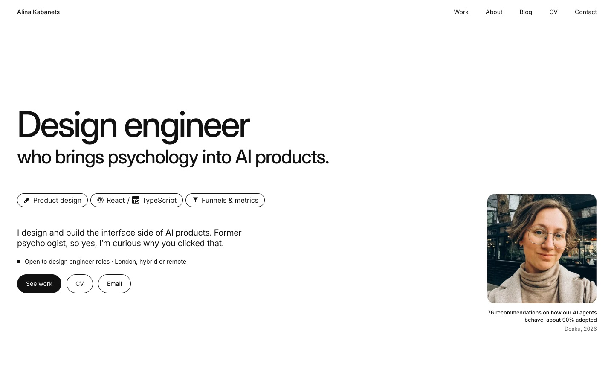
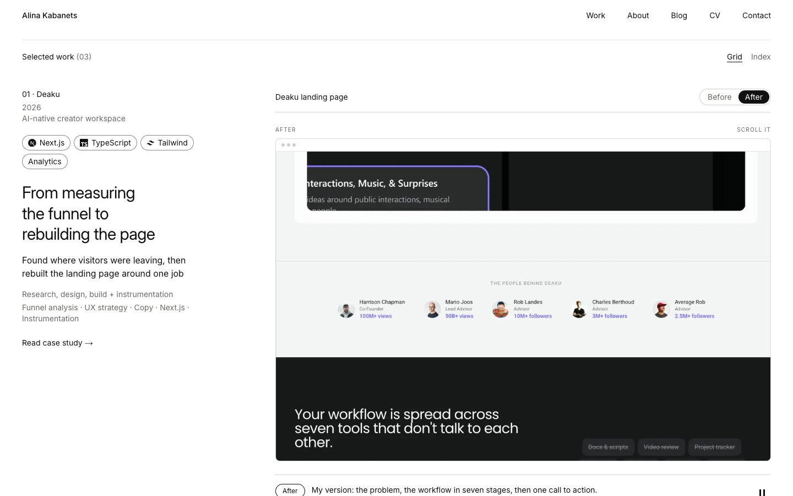
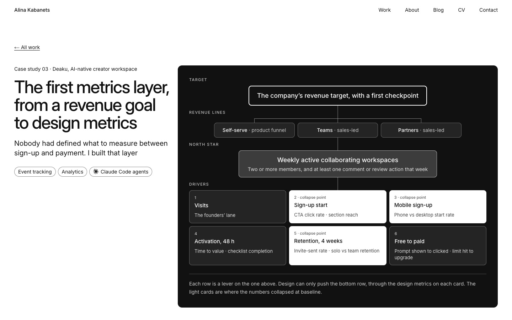
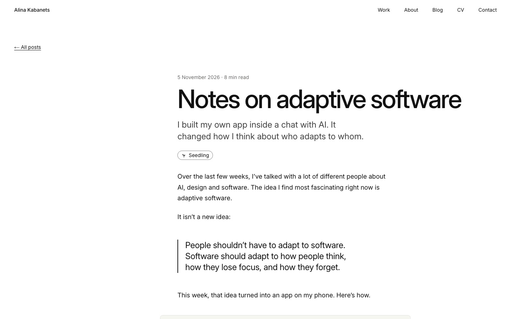
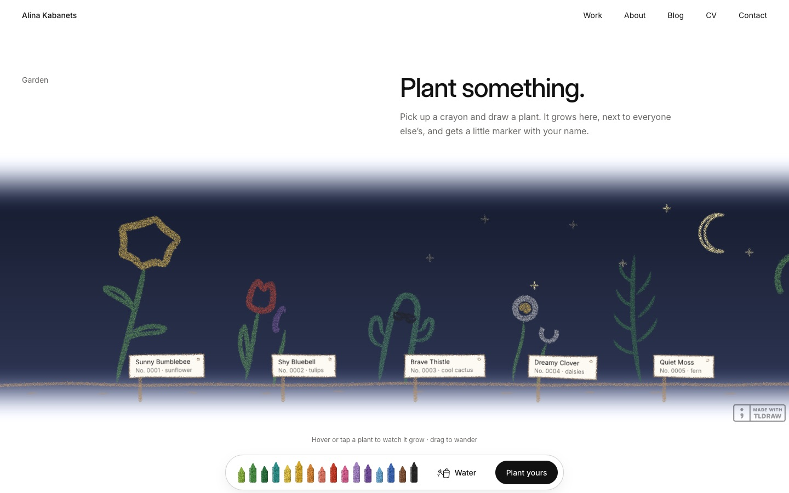

# alinakabanets.com

My portfolio as a design engineer who brings psychology into AI products: three case studies, a blog, and a garden where visitors draw a plant.

**Live site: [alinakabanets.com](https://alinakabanets.com)**



## What's on it

### Case studies

- **[From measuring the funnel to rebuilding the page](https://alinakabanets.com/work/deaku-landing-page)**: finding where visitors left Deaku's landing page, then redesigning, rebuilding and instrumenting it.
- **[Two healthcare MVPs, designed from scratch](https://alinakabanets.com/work/vigorant-healthcare-mvps)**: a patient portal and an admin portal for Borna Care, from research and user flows to a design system and shipped UI.
- **[The first metrics layer, from a revenue goal to design metrics](https://alinakabanets.com/work/deaku-kpi-tree)**: Deaku's first KPI tree, from the revenue target down to the design metrics, with one north-star metric.





### Blog

Notes on designing and building AI products, starting with [Notes on adaptive software](https://alinakabanets.com/blog/notes-on-adaptive-software).



### Garden

[Plant something](https://alinakabanets.com/garden): pick up a crayon, draw a plant, and it grows next to everyone else's with a little wooden marker carrying your name. You can water other people's plants too.



## Things I built for it

| | |
|---|---|
| **Hero layout** | The homepage hero is laid out like a poster: each block has a position and width relative to the page, so it scales with the screen. On phones the blocks stack. |
| **Product demo player** | Plays a product story scene by scene: a phone screen and an admin screen side by side, a caption that types itself out, and long screens that scroll. Built from still images and code, so it stays sharp and loads fast. |
| **Before / after player** | Switches between the old landing page and a screen recording of the new one. |
| **Case study blocks** | Sections, figures with captions, diagrams, ratio-only charts, a permissions table and a code block, so every case study follows the same structure. |
| **Blog** | Posts are Markdown files. Images get their real sizes so the page doesn't jump, open full size on click, and line up in rows. Each post has a status: seedling, growing or evergreen. |
| **Crayon garden** | A [tldraw](https://tldraw.dev) canvas with custom shapes and tools: crayon strokes, plants that grow on hover, wooden name markers and a watering can. New plants wait for my approval before they appear for everyone. |
| **Link preview cards** | Every page, case study and post gets its own generated preview image for LinkedIn, X and messages. |
| **Content as data** | All text and project details live in `content/`, separate from the components that display them. |

## How it's built

- **Next.js 16** (App Router), **React 19**, **TypeScript** and **Tailwind CSS 4**.
- **Every page is static.** Pages are prebuilt as HTML and served by Vercel. The one exception is the garden, whose plants load in the browser from a small API backed by Upstash Redis.
- **Motion never blocks content.** Demos play only while on screen, can always be paused, and stay still for visitors who have reduced motion turned on.
- **Accessible by default:** semantic HTML, a skip link, visible keyboard focus, alt text on every image, and captions that screen readers get in full.
- **Link previews and SEO:** canonical URLs, a sitemap and structured data.
- **Security headers,** including a content security policy, set in `next.config.ts`.
- **Privacy:** no cookies. Cookieless analytics (Umami) counts visits and a few clicks, such as opening a case study or the CV.

## Project structure

```
app/          Pages, metadata, sitemap, preview images, garden API
components/   Hero, work list, demo players, case study blocks, blog, garden
content/      Profile, projects, case study write-ups, blog posts
lib/          Shared helpers: blog, preview cards, garden storage
public/       Images, videos and the CV
```

## Run it locally

```bash
npm install
npm run dev      # http://localhost:3000
npm run lint
npm run build    # production build
```

Pushing to `main` deploys to Vercel.

## How I worked

I designed this site directly in code and built it with [Claude Code](https://claude.com/claude-code) as a pair. I set the direction, structure, copy and visual decisions, and reviewed every change in the browser before it shipped.

## Using this code

You're welcome to read the code and learn from it. The text, photographs, case study images and recordings are my own work or shown with permission, so please don't reuse them.

## Contact

[aokabanets@gmail.com](mailto:aokabanets@gmail.com) · [LinkedIn](https://www.linkedin.com/in/alina-kabanets/) · London, UK
